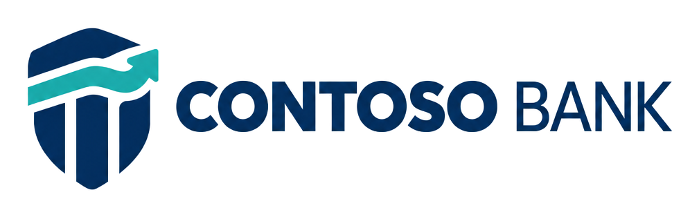
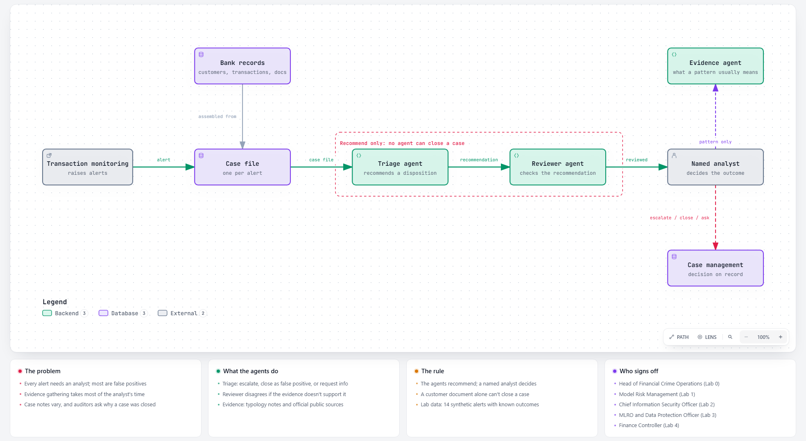
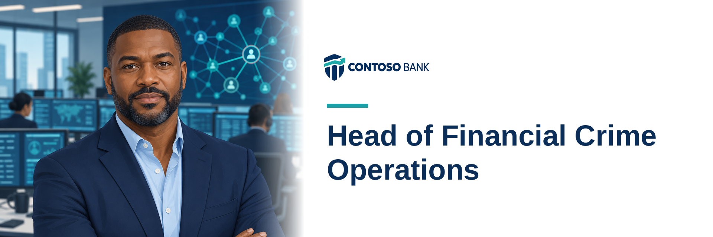
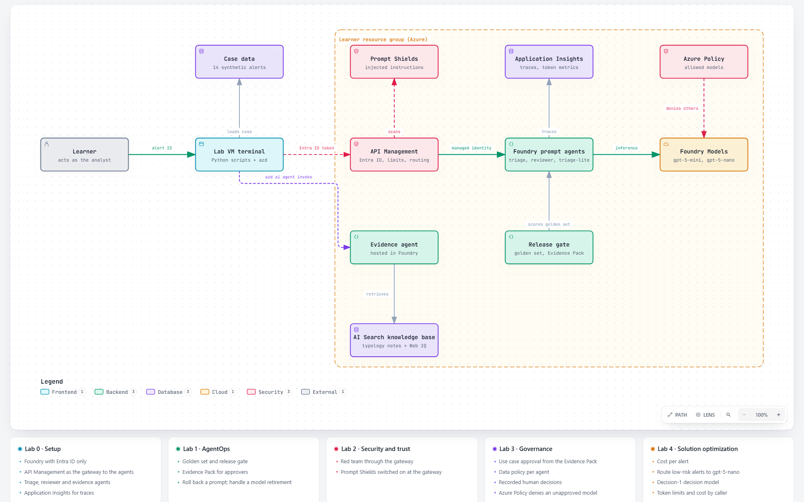

<a name="start-building"></a>

<p align="center">

</p>

# [Microsoft Ignite 2026](https://ignite.microsoft.com)

## 🔥PREL35: Building a path to production for agents
### Session description

Move beyond AI prototypes and learn how to operationalize agents for enterprise use. In this 4-hour hands-on lab, you'll apply Microsoft's Path to Production framework to assess readiness, implement governance and security controls, deploy with Microsoft Foundry, and establish monitoring and observability practices. Leave with a practical blueprint, reference architectures, and operational guidance to build, deploy, and manage AI agents at scale.

### 🏦 The scenario

<p align="left">

</p>

Contoso Bank's transaction monitoring raises financial crime alerts every day, and most turn out to be false
positives. Three agents help a human analyst work the queue: **triage** recommends what to do with an alert,
**reviewer** checks that recommendation, and **evidence** researches what a pattern usually means without seeing who
the customer is. **The agents recommend; a named analyst decides.** All data is synthetic.



### 👥 Stakeholders

Before the agents go live, five people at Contoso Bank have to sign off. Each lab answers one of their questions.

| Lab | Stakeholder | Their question |
| --- | ----------- | -------------- |
| 0 - Setup | <br/>**Head of Financial Crime Operations** | Can the agents just close these alerts? |
| 1 - AgentOps | <br/>**Head of Model Risk Management** | The model we validated is being retired. How do we know a change is still good enough? |
| 2 - Security and trust | <br/>**Chief Information Security Officer** | A customer uploaded a letter telling the agent to mark their case low risk. What stops that? |
| 3 - Governance | <br/>**Money Laundering Reporting Officer and Data Protection Officer** | Who approved this, what does each agent see, and is a person really deciding? |
| 4 - Solution optimization | <br/>**Finance Controller** | What does each alert cost, and who pays? |

### 🏗️ Solution architecture

Everything runs in the learner's own Azure resource group. Lab scripts reach the agents only through API Management,
which checks the Entra ID token, applies Prompt Shields, routes between models and limits tokens per caller.



### 🚀 Getting started

#### In a guided session

If you're attending the live session at Microsoft Ignite:

1. Sign in to the lab VM that Skillable provides. Your Azure resource group is already deployed.
2. Follow the guide in the Skillable lab window, starting with the
   [introduction and agenda](instructions/introduction.md).

#### On your own

If you're learning at your own pace, in your own Azure subscription:

1. Clone this repository and install [uv](https://docs.astral.sh/uv/) and the
   [Azure Developer CLI](https://learn.microsoft.com/azure/developer/azure-developer-cli/install-azd).
2. Deploy the lab landing zone into a resource group, as described in [infra/README.md](infra/README.md).
3. Work through the [attendee instructions](instructions/README.md) in order, from Lab 0 to Lab 4.

#### Console colors

The Python setup commands, `uv run create-agents`, `src/investigate.py`, and `src/evaluate.py` use colors in interactive terminals. Redirected output and saved reports stay plain.

Set the `NO_COLOR` environment variable to disable colors, regardless of its value (even an empty value).

**Bash (for one command):**

```bash
NO_COLOR=1 uv run src/evaluate.py
```

**PowerShell (for the current session):**

```powershell
$env:NO_COLOR = "1"
uv run src/evaluate.py
```

Remove the variable to restore automatic colors: `unset NO_COLOR` in Bash or `Remove-Item Env:NO_COLOR` in PowerShell.

#### Setup commands and tests

Run `uv run setup-lab --resource-group <your-resource-group>` to configure an existing lab's settings,
Search index and knowledge base. It leaves prompt-agent publishing to
[Lab 0](instructions/lab-0-setup/README.md). Setup commands are Python entry points in `pyproject.toml`;
only Skillable's cloud-hosted lifecycle actions remain PowerShell.

Run the offline test suite with `uv run pytest`. GitHub Actions runs it on Linux and Windows with Python
3.12 and 3.13 for pull requests and pushes to `main`. Tests mock Azure access and do not require credentials.

### 🎯 Learning outcomes

By the end of this session, you will be able to:

- Gate each agent release on measured quality, with evaluations, traces and versioned evidence you can roll back to.
- Red team your agents and block prompt injection at an AI gateway with Prompt Shields, then show what changed.
- Govern and cost agents in production: approved use cases, data policies, human decisions, Azure Policy,
  cost per alert, model routing and token limits per caller.

### 💻 Technologies used

- [Microsoft Foundry](https://learn.microsoft.com/azure/ai-foundry/what-is-azure-ai-foundry) and
  [Foundry Agent Service](https://learn.microsoft.com/azure/ai-foundry/agents/overview)
- [Foundry Models](https://learn.microsoft.com/azure/ai-foundry/foundry-models/concepts/models-sold-directly-by-azure)
  (gpt-5-mini, gpt-5-nano and [Microsoft Decision](https://learn.microsoft.com/azure/foundry/foundry-models/how-to/use-foundry-models-microsoft-decision))
- [Evaluations in Microsoft Foundry](https://learn.microsoft.com/azure/ai-foundry/concepts/observability)
- [Azure API Management AI gateway](https://learn.microsoft.com/azure/api-management/genai-gateway-capabilities)
- [Prompt Shields in Azure AI Content Safety](https://learn.microsoft.com/azure/ai-services/content-safety/concepts/jailbreak-detection)
- [Azure AI Search agentic retrieval](https://learn.microsoft.com/azure/search/agentic-retrieval-overview)
- [Web IQ](https://learn.microsoft.com/web-iq/integrations/mcp)
- [Application Insights](https://learn.microsoft.com/azure/azure-monitor/app/app-insights-overview)
- [Azure Policy](https://learn.microsoft.com/azure/governance/policy/overview)
- [Microsoft Entra ID](https://learn.microsoft.com/entra/fundamentals/whatis)
- [Bicep](https://learn.microsoft.com/azure/azure-resource-manager/bicep/overview) and the
  [Azure Developer CLI](https://learn.microsoft.com/azure/developer/azure-developer-cli/overview)

### 📚 Continue your learning

Pick your next step based on your learning style:

| Resource | What you'll get |
|----------|-----------------|
| **[Ignite 2026 Next Steps](https://aka.ms/ignite26-next-steps)** | Additional session repos and materials from Microsoft Ignite 2026 |
| **[Microsoft AI Skills Navigator](https://aka.ms/ignite26-asn)** | Discover AI skills, learning paths, and resources for your next step |
| **[Microsoft Learn](https://aka.ms/ignite26-learn)** | Official documentation and guided learning paths on these topics |
| **[Microsoft Foundry Community](https://aka.ms/MicrosoftFoundryDiscord-Ignite26)** | Connect with other learners and experts in our Discord community |

### 🌟 Microsoft Learn MCP Server

The Microsoft Learn MCP Server gives your AI agent direct access to Microsoft's official documentation — grounded, up-to-date answers about the topics in this session.

**GitHub Copilot CLI** — Install with:

```shell
copilot plugin install microsoftdocs/mcp
```

**VS Code** — One-click install:  
[](https://vscode.dev/redirect/mcp/install?name=microsoft-learn&config=%7B%22type%22%3A%22http%22%2C%22url%22%3A%22https%3A%2F%2Flearn.microsoft.com%2Fapi%2Fmcp%22%7D)

For more information, visit the [Learn MCP Server repo](https://aka.ms/learnmcp).

### 👥 Content owners

<table>
<tr>
    <td align="center"><a href="https://github.com/tbhamidipati">
        <br />
        <sub><b>Tanuja Bhamidipati</b></sub></a><br />
            <a href="https://github.com/tbhamidipati" title="talk">📢</a>
    </td>
    <td align="center"><a href="https://github.com/karpikpl">
        <br />
        <sub><b>Piotr Karpala</b></sub></a><br />
            <a href="https://github.com/karpikpl" title="talk">📢</a>
    </td>
</tr></table>

### ⚖️ Trademarks

This project may contain trademarks or logos for projects, products, or services. Authorized use of Microsoft trademarks or logos is subject to and must follow [Microsoft's Trademark & Brand Guidelines](https://www.microsoft.com/legal/intellectualproperty/trademarks/usage/general). Use of Microsoft trademarks or logos in modified versions of this project must not cause confusion or imply Microsoft sponsorship.

Any use of third-party trademarks or logos are subject to those third-party's policies.
