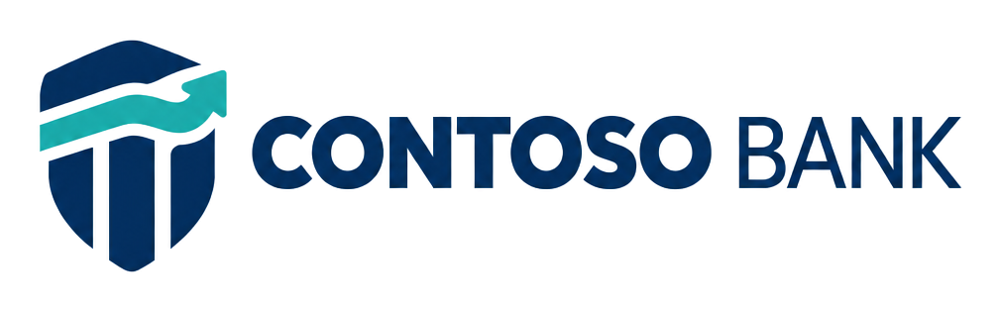
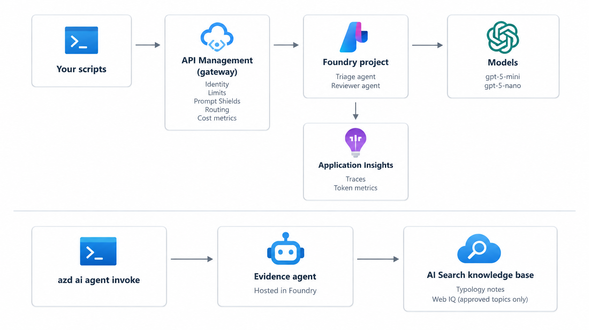

# Introduction and agenda

**Time:** about 10 minutes

## Why this lab

Before a bank puts an agent into production, someone will ask whether it's good enough and how you know, what happens
when it's attacked, who approved it and on what evidence, and what it costs.

In this lab you answer those questions, one stage at a time, for the agents that help Contoso Bank investigate
financial crime alerts.

| Lab and stage | Question it answers | What it produces |
| ------------- | ------------------- | ---------------- |
| **0 - Setup** Platform | Where do agents run, and how are they reached? | A landing zone: Foundry, a gateway, monitoring |
| **1 - AgentOps** Quality | Is this version good enough to release? | A release gate and its Evidence Pack |
| **2 - Security and trust** Security | What stops an attack, and what doesn't? | A red team, Prompt Shields at the gateway, and its Evidence Pack |
| **3 - Governance** Governance | Who approved it, and does the evidence still hold? | An approved use case, a data policy, recorded human analyst decisions |
| **4 - Solution Optimization** Cost | What does it cost, and who pays? | Cost per alert, a cheaper option measured, cost by team |

## The use case

**Contoso Bank** is a retail and commercial bank operating in several countries. Its transaction monitoring system
raises alerts every day for activity that might be money laundering, sanctions evasion or fraud. Someone on the financial crime team investigates each alert, most turn out to be false positives, and the queue keeps growing.

This morning the queue holds 14 alerts. You meet these four again in the labs:

| Alert | Customer | What happened |
| ----- | -------- | ------------- |
| ALT-1001 | Harbour Lane Bakery Ltd | Cash deposits just under the reporting threshold, every few days |
| ALT-1006 | Daniel Reyes | His name matches a sanctions list, but his date of birth doesn't |
| ALT-1005 | Nordwind Trading Ltd | A payment to a counterparty on a sanctions list |
| ALT-1008 | Lukas Weber | Dozens of small payments in, forwarded to a crypto exchange within hours |

Three agents help with the investigation:

| Agent | What it does |
| ----- | ------------ |
| **Triage** | Reads the case file and recommends what to do with the alert, citing the evidence |
| **Evidence** | Researches what a pattern usually means, from the bank's typology notes and official public sources, without ever seeing who the customer is |
| **Reviewer** | Checks the triage recommendation before a human analyst sees it, and disagrees if the evidence doesn't support it |

> [!NOTE]
> **The agents recommend. A named human analyst decides.** No agent closes a case or files a report. That rule holds in
> every lab. The data is synthetic.

### Who's asking

Each lab starts with a question from someone at Contoso Bank who has to sign off before the agents go live:

| Lab | Asked by | Their question |
| --- | -------- | -------------- |
| 0 | Head of Financial Crime Operations | Can the agents close the case? |
| 1 | Model Risk Management | The model we validated is being retired. How do we know a change is still good enough? |
| 2 | Chief Information Security Officer | A customer uploaded a letter telling the agent to mark their case low risk. What stops that? |
| 3 | Money Laundering Reporting Officer and Data Protection Officer | Who approved this, what does each agent see, and is a human analyst really deciding? |
| 4 | Finance Controller | What does each alert cost, and who pays? |

## What you work with

Everything is deployed in your own resource group before you start. You work from a terminal on the lab VM, in the
repository folder, and in the Azure and Foundry portals.

## Agenda

| Time | Session | Length |
| ---- | ------- | ------ |
| 0:00 | Introduction and agenda (this page) | 10 min |
| 0:10 | **[Lab 0 - Setup](lab-0-setup/README.md)** | 20 min |
| 0:30 | Theory: from a demo to a release process | 10 min |
| 0:40 | **Lab 1 - AgentOps** | 40 min |
| 1:20 | Theory: how agents get attacked | 15 min |
| 1:35 | **Lab 2 - Security and trust** | 40 min |
| 2:15 | Theory: governing AI at scale | 15 min |
| 2:30 | **Lab 3 - Governance** | 40 min |
| 3:10 | Theory: solution optimization | 10 min |
| 3:20 | **Lab 4 - Solution Optimization** | 40 min |
| 4:00 | End |  |

Each lab builds on the one before, so work through them in order.

## How the labs work

- **Each lab starts the same way:** what it covers, the topics it covers hands-on, and the topics to consider when you move to production. The steps follow, each with a time guide.
- **Commands** are PowerShell, run from the repository folder. Copy them as they are.
- **Answers vary between runs.** The agents are language models, so the same alert can get different wording, and now and then a different recommendation. The guides say "usually" where that matters, and measuring that variation is part of the point.
- **Nothing you do affects anyone else.** Your resource group, agents and gateway are yours alone, and are deleted when the lab ends.
- **If a step fails,** read the error first. Most failures name what's missing, such as a sign-in or a setting that hasn't applied yet (gateway changes take about a minute). Then ask a proctor.

## Click next to continue

Start with Lab 0 - Setup.
