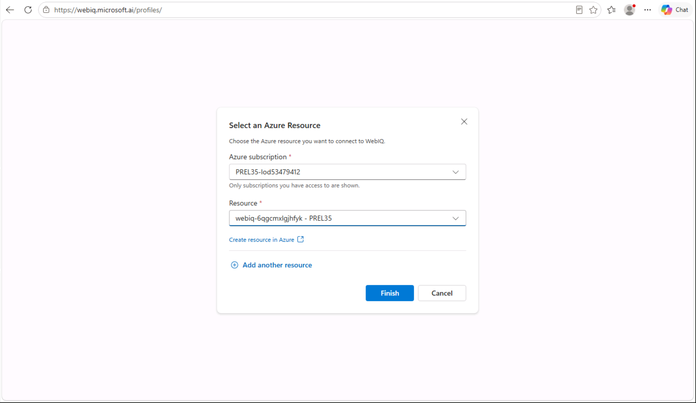
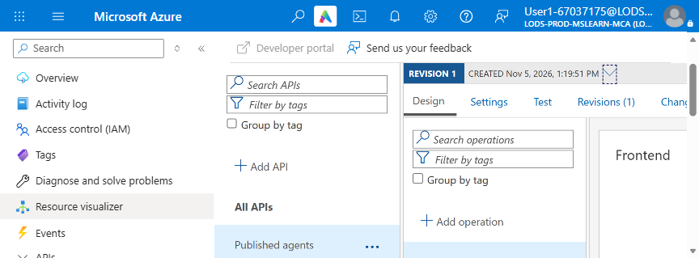
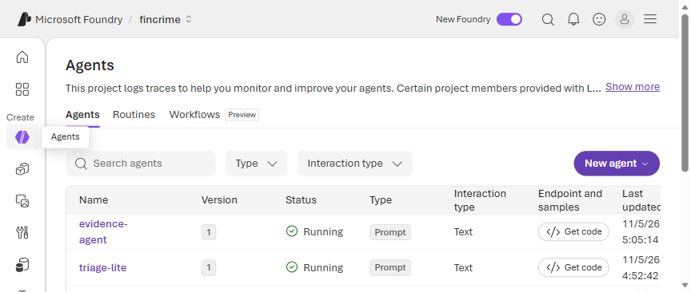

# Lab 0 - Setup

**Time:** about 20 minutes

## What this lab covers

> **Contoso Bank's Head of Financial Crime Operations asks:** "Most of these alerts are false positives. Can the
> agents just close them?"
>
> No. The agents recommend; a named human analyst decides. In this lab you set up the platform that holds that line, and
> run the first alert in the queue: Harbour Lane Bakery.

You connect to your lab environment, tour it as a small AI landing zone, deploy the agents, and run your first
alert. Everything you deploy, measure and protect in Labs 1 to 4 builds on this.

### The use case

Contoso Bank's transaction monitoring system raises **alerts**: activity that might be money laundering, sanctions
evasion or fraud. A human analyst investigates every alert, and most turn out to be false positives. Three agents help:

| Agent | What it does |
|---|---|
| **Triage** | Reads the case file and recommends a disposition (escalate, close as a false positive, or request more information), citing the evidence |
| **Reviewer** | Checks the triage recommendation before a human sees it, and disagrees if the evidence doesn't support it |
| **Evidence** | Researches what a pattern usually means, using only approved topics, never the customer's identity. You use it in Lab 3 |

**The agents recommend. A named human analyst decides.** No agent can close a case.

The data is synthetic: 14 alerts in [data/cases.json](../../data/cases.json), introduced in the
[introduction](../introduction.md).

### What's deployed in your resource group

```text
investigate.py  ──(your Entra ID token)──►  API Management  ──(its managed identity)──►  Foundry project
                                            checks token,                                triage + reviewer agents
                                            rate limit per caller                        gpt-5-mini
                                                                                              │
                                                                         Application Insights ◄┘ traces
```

- **Foundry** accepts Entra ID only: no API keys exist.
- **API Management** is the way apps reach the agents. Only agents published as gateway operations can be called
  through it. You also have direct access to Foundry, for the Foundry portal and the evaluations in Lab 1; in
  production, a private endpoint and no data-plane roles for people would close that path.
- The infrastructure is [Bicep](../../infra/main.bicep), deployed for you before the lab started. The agents are
  defined in [src/agents](../../src/agents), and you publish them in step 2.

## Topics covered

- Landing zone building blocks: identity, gateway, monitoring
- Infrastructure as code for the platform, and agents as versioned definitions
- Calling agents through a gateway, with no keys

## Prerequisites

Provided on the lab VM: Azure CLI, Azure Developer CLI (`azd`) with the extensions listed in
[azure.yaml](../../azure.yaml), PowerShell 7 for the terminal examples, uv with Python 3.12, and this repository.
The Python packages and setup commands are defined in [pyproject.toml](../../pyproject.toml). Your resource group and sign-in details are on the
**Resources** tab of the lab instructions.

## Steps

### 1. Sign in and connect (3 min)

Open a **PowerShell 7** terminal in the repository folder: type `pwsh` in a terminal if the prompt doesn't already
start with `PS 7`. Windows PowerShell 5.1 can't run the setup. Every command in these labs runs from this folder.

Sign in. Use the username `<lab-username>` and the password `<lab-password>`:

```powershell
az login
```

Prepare the existing lab. Your resource group name is on the **Resources** tab of the lab instructions:

```powershell
uv run setup-lab --resource-group <your-resource-group>
```

uv installs the Python dependencies automatically. Setup saves `.env`, creates and seeds the Search index,
and creates its knowledge base. It does not deploy infrastructure, assign roles or publish prompt agents.
Setup uses colored progress messages in a terminal; set `NO_COLOR=1` to disable colors.

### 2. Publish the agents (2 min)

Each agent is a Markdown file of instructions in [src/agents](../../src/agents). Publishing creates a new version of
each agent in Foundry:

```powershell
uv run create-agents
```

You see three agents:

```text
reviewer version 1 (gpt-5-mini)
triage version 1 (gpt-5-mini)
triage-lite version 1 (gpt-5-nano)
```

`triage-lite` has the same instructions as triage on a smaller model; you use it in Lab 4. In Lab 1 you change an
agent and publish version 2 the same way.

### 3. Deploy the evidence agent (4 min)

Triage and the reviewer are prompt agents: instructions only. The evidence agent is a **hosted agent**: Python code
in [src/agents/evidence](../../src/agents/evidence) that Foundry runs for you. It researches through the Search
knowledge base you created in step 1, which combines the bank's typology notes with official public sources from
**Web IQ**.

Connect Web IQ and prepare the deployment:

```powershell
uv run configure-evidence-agent
```

If you're asked for a key, the command opens the Web IQ profile portal. Select the profile linked to the billing
resource shown in the terminal, create an API key with the **web** service enabled, and paste it into the hidden
prompt. The key is saved in `.env`, which Git ignores.




When the command reports that Web IQ and the evidence-agent environment are ready, deploy:

```powershell
azd deploy
```

Foundry builds the agent remotely, which takes a few minutes. Leave it running, open a second terminal in the
repository folder, and carry on with step 4. You use the evidence agent in Lab 3.

### 4. Tour the landing zone (3 min)

In the [Azure portal](https://portal.azure.com), open your resource group and find:


| Resource | Look for |
|---|---|
| Foundry (`aif-…`) | **Resource Management > Keys and Endpoint**: local (key) authentication is disabled |
| API Management (`apim-…`) | **APIs > Published agents**: one operation per agent. Select **All operations**, then the **</>** icon under **Inbound processing** to open the policy: token check, rate limit, managed identity |
| Application Insights (`appi-…`) | Where agent traces land. You use it in Lab 1 |




Then open the [Foundry portal](https://ai.azure.com), select the `fincrime` project, and open **Agents**. You see
**triage** and **reviewer**. Open triage and read its instructions: they're the same text as
[src/agents/triage.md](../../src/agents/triage.md).

When `azd deploy` has finished, **Agents** also shows **evidence-agent** as a hosted agent.



### 5. Run your first investigation (4 min)

The first alert in the queue is ALT-1001: Harbour Lane Bakery Ltd has been depositing cash just under the reporting
threshold every few days. Is it structuring, or just a busy bakery?

```powershell
uv run src/investigate.py ALT-1001
```

You see the triage recommendation, then the reviewer's verdict. Triage usually recommends `escalate`, and lists
the IDs of the deposits it relied on, such as `T-00001`: every claim points to something in the case file. The
reviewer usually agrees. Nothing happens to the case: deciding it is the human analyst's job, which you do in Lab 3.

Run it a second time. The wording, and sometimes the recommendation, can change between runs. That variation is
why Lab 1 measures agents with evaluations instead of trusting a single run.

### 6. Get refused on purpose (3 min)

Call the gateway without a token:

```powershell
$gw = (Get-Content .env | Select-String '^APIM_GATEWAY_URL=').Line.Split('=', 2)[1]
curl.exe -s -o NUL -w "%{http_code}`n" -X POST "$gw/agents/triage/responses"
```

You get `401`: the gateway rejects the request before it reaches Foundry.

Now call an agent that isn't published, with a valid token:

```powershell
$token = az account get-access-token --resource https://ai.azure.com --query accessToken -o tsv
curl.exe -s -o NUL -w "%{http_code}`n" -X POST "$gw/agents/unpublished/responses" -H "Authorization: Bearer $token"
```

You get `404`: only agents published as gateway operations can be reached.

### 7. Check your understanding (1 min)

- Your token reaches API Management. What identity does API Management use to reach Foundry?
  *Its own managed identity. Callers never get access to Foundry through the gateway.*
- Where would you change the triage agent's behaviour, and how would that change reach Foundry?
  *In [src/agents/triage.md](../../src/agents/triage.md), published as a new version with `uv run create-agents`.*
- Who decides the outcome of an alert?
  *A named human analyst. The agents only recommend.*

## Next

Continue to [Lab 1 - AgentOps](../lab-1-agentops/README.md).
