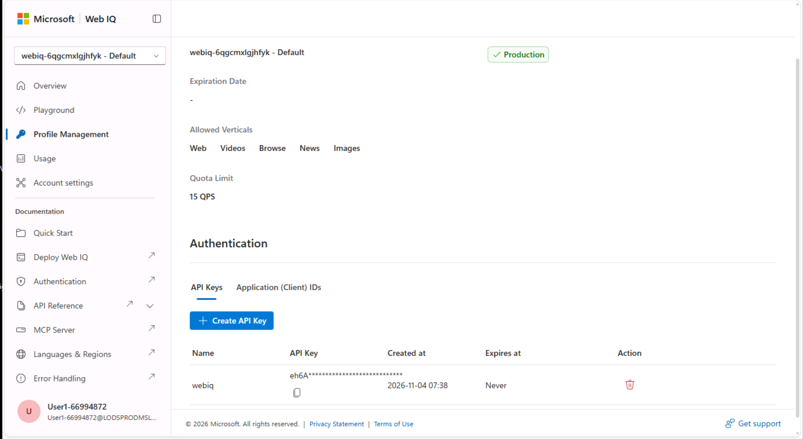

# Lab 0 - Setup

**Time:** about 20 minutes

## What this lab covers

> **Contoso Bank's Head of Financial Crime Operations asks:** "Most of these alerts are false positives. Can the
> agents just close them?"
>
> No. The agents recommend; a named human analyst decides. In this lab you set up the platform that holds that line, and
> run the first alert in the queue: Harbour Lane Bakery.

You connect to your lab environment, tour it as a small AI landing zone, deploy the agents, and run your first
alert. Everything you deploy, measure and protect in Labs 1 to 4 builds on this.

### The use case

Contoso Bank's transaction monitoring system raises **alerts**: activity that might be money laundering, sanctions
evasion or fraud. A human analyst investigates every alert, and most turn out to be false positives. Three agents help:

| Agent | What it does |
| ----- | ------------ |
| **Triage** | Reads the case file and recommends a disposition (escalate, close as a false positive, or request more information), citing the evidence |
| **Reviewer** | Checks the triage recommendation before a human sees it, and disagrees if the evidence doesn't support it |
| **Evidence** | Researches what a pattern usually means, using only approved topics, never the customer's identity. You use it in Lab 3 |

**The agents recommend. A named human analyst decides.** No agent can close a case.

The data is synthetic: 14 alerts in [data/cases.json](../../data/cases.json), introduced in the [introduction](../introduction.md).

### What's deployed in your resource group

```text
investigate.py  ──(your Entra ID token)──►  API Management  ──(its managed identity)──►  Foundry project
                                            checks token,                                triage + reviewer agents
                                            rate limit per caller                        gpt-5-mini
                                                                                              │
                                                                         Application Insights ◄┘ traces
```

- **Foundry** accepts Entra ID only: no API keys exist.
- **API Management** is the way apps reach the agents. Only agents published as gateway operations can be called through it. You also have direct access to Foundry, for the Foundry portal and the evaluations in Lab 1; in production, a private endpoint and no data-plane roles for people would close that path.
- The infrastructure is [Bicep](../../infra/main.bicep), deployed for you before the lab started. The agents are defined in [src/agents](../../src/agents), and you publish them in step 2.

## Topics covered

- Landing zone building blocks: identity, gateway, monitoring
- Infrastructure as code for the platform, and agents as versioned definitions
- Calling agents through a gateway, with no keys

## Prerequisites

Provided on the lab VM: Azure CLI, Azure Developer CLI (`azd`) with the extensions listed in [`azure.yaml`](../../azure.yaml), PowerShell, uv with a Python 3.12 environment holding the packages in [`pyproject.toml`](../../pyproject.toml), and this repository. Your resource group and sign-in details are on the **Resources** tab of the lab instructions.

## Steps

### 1. Sign in and connect \(3 min\)

- [] Open a **PowerShell** terminal (Click Start -> type `Terminal`). Navigate to the repository folder, where every command in these labs runs:

```powershell
cd C:\Users\LabUser\Desktop\ignite26-PREL35
```

- [] Sign in to Azure using username +++<lab-username>+++ and the access token +++<lab-access-token>+++.

```powershell
az login
```

You can skip the "Automatically sign in to Microsoft sites like Bing and Outlook" option when prompted.

Optionally, open the repository in VS Code:

```powershell
code .
```

- [] Prepare the existing lab using your resource group name:

```powershell
uv run setup-lab --resource-group <your-resource-group>
```

uv installs the Python dependencies automatically. Setup saves `.env`, creates and seeds the Search index,
and creates its knowledge base.

### 2. Publish the agents \(2 min\)

Each agent is a Markdown file of instructions in [src/agents](../../src/agents). Publishing creates a new version of each agent in Foundry:

```powershell
uv run create-agents
```

> To disable colors in the terminal output, set the environment variable `UV_NO_COLOR` to `1` using  
>
> ```powershell
> $env:UV_NO_COLOR = "1"
> ```

- [] You see four agents:

```text
reviewer version 1 (gpt-5-mini)
triage version 1 (gpt-5-mini)
triage-systemone version 1 (gpt-5-mini)
triage-lite version 1 (gpt-5-nano)
```

`triage-lite` has the same instructions as triage on a smaller model; you use it in Lab 4. In Lab 1 you change an
agent and publish version 2 the same way.
`triage-systemone` explains recommendations made by the decision model; you try it in Lab 4.

### 3. Deploy the evidence agent \(4 min\)

Triage and the reviewer are prompt agents: instructions only. The evidence agent is a **hosted agent**: Python code
in [`src/agents/evidence`](../../src/agents/evidence) that Foundry runs for you. It researches through the Search knowledge base you created in
step 1, which combines the bank's typology notes with official public sources from **Web IQ**.

- [] Connect Web IQ and prepare the deployment:

```powershell
uv run configure-evidence-agent
```

If you're asked for a key, the command opens the Web IQ portal. 




Select the profile linked to the billing resource shown in the terminal. You'll see "You're ready to use WebIQ", select **Skip** on that screen. Then create an API key with the **web** service enabled, and paste it into the hidden prompt. The key is saved in `.env`, which Git ignores.

- [] When the command reports that Web IQ and the evidence-agent environment are ready, deploy:

```powershell
azd deploy
```

Foundry builds the agent remotely, which takes a few minutes. Leave it running, open a second terminal in the
repository folder, and carry on with step 4. You use the evidence agent in Lab 3.

### 4. Tour the landing zone \(3 min\)

- [] Open the **Azure portal** +++<azure-portal-url>+++. Login using +++<lab-username>+++ and the access token +++<lab-access-token>+++.

Find your resource group <your-resource-group> and deployed resources:


| Resource | Look for |
| -------- | -------- |
| Foundry (`<foundry-name>`) | **Resource Management > Keys and Endpoint**: local (key) authentication is disabled |
| API Management (`<apim-name>`) | **APIs > Published agents**: one operation per agent. Select **All operations**, then the **</>** icon under **Inbound processing** to open the policy: token check, rate limit, managed identity |
| Application Insights (`<appinsights-name>`) | Where agent traces land. You use it in Lab 1 |


Then open the **Foundry portal** `https://ai.azure.com`. By either going direct to the URL, or through Azure Portal ──► Foundry ──► blue button "Go to Foundry Portal".

- [] Open the Foundry Portal

Select the `fincrime` project, and open **Build** ──► **Agents**. You see the four agents you published: **triage**, **reviewer**, **triage-lite** and **triage-systemone**. Open triage and read its instructions: they're the same text as [`src/agents/triage.md`](../../src/agents/triage.md). When `azd deploy` has finished, **Agents** also shows **evidence-agent** as a hosted agent.


### 5. Run your first investigation \(4 min\)

The first alert in the queue is ALT-1001: Harbour Lane Bakery Ltd has been depositing cash just under the reporting
threshold every few days. Is it structuring, or just a busy bakery?

- [] In the terminal, run the investigation script for ALT-1001:

```powershell
uv run src/investigate.py ALT-1001
```

You see the triage recommendation, then the reviewer's verdict. Triage usually recommends `escalate`, and lists the
IDs of the deposits it relied on, such as `T-00001`: every claim points to something in the case file. The reviewer
usually agrees. Nothing happens to the case: deciding it is the human analyst's job, which you do in Lab 3.

Run it a second time. The wording, and sometimes the recommendation, can change between runs. That variation is why Lab 1 measures agents with evaluations instead of trusting a single run.

### 6. Get refused on purpose \(3 min\)

The gateway only accepts requests that carry an Entra ID access token in the `Authorization` header. 
- [] Call it without one:

```powershell
curl.exe -s -o NUL -w "%{http_code}`n" -X POST "<apim-gateway-url>/agents/triage/responses"
```

You get `401`: the gateway rejects the request before it reaches Foundry.

- [] Now get an Entra ID token for your signed-in user and call an agent that isn't published:

```powershell
$token = az account get-access-token --resource https://ai.azure.com --query accessToken -o tsv
curl.exe -s -o NUL -w "%{http_code}`n" -X POST "<apim-gateway-url>/agents/unpublished/responses" -H "Authorization: Bearer $token"
```

You get `404`: only agents published as gateway operations can be reached.

### 7. Check your understanding \(1 min\)

- Your token reaches API Management. What identity does API Management use to reach Foundry?
  *Its own managed identity. Callers never get access to Foundry through the gateway.*
- Where would you change the triage agent's behaviour, and how would that change reach Foundry?
  *In [`src/agents/triage.md`](../../src/agents/triage.md), published as a new version with `uv run create-agents`.*
- Who decides the outcome of an alert?
  *A named human analyst. The agents only recommend.*

## Click next to continue

Continue to [Lab 1 - AgentOps](../lab-1-agentops/README.md).
