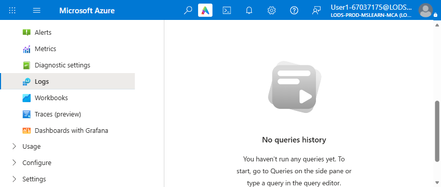
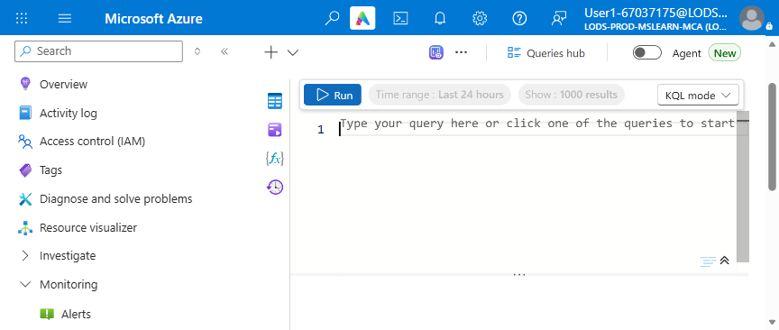
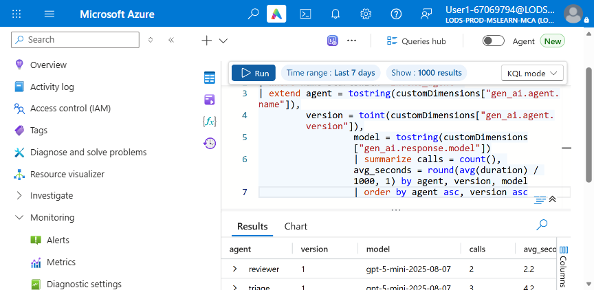
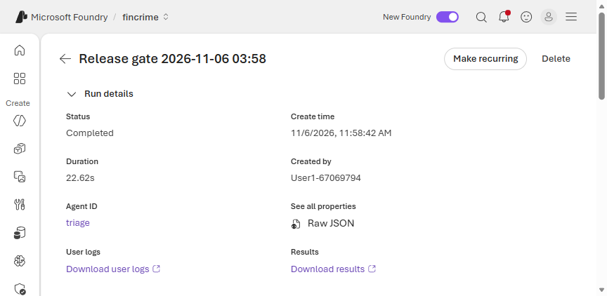

# Lab 1 - AgentOps

> [!NOTE]
> **Time:** about 40 minutes
>
> **Objective:** Operate agents and models through production-grade, governed processes.

## What this lab covers


> **Contoso Bank's Head of Model Risk Management asks:** *"The model we validated is being retired. Every time you
> change a prompt or a model, how do we know the agents are still good enough?"*
>
> The answer is a release gate that runs on every change.
>
> The case to watch is ALT-1006: Daniel Reyes's name matches a sanctions list, but his date of birth doesn't. The right answer is to close it as a false positive, and it's the one a careless change gets wrong.

In **[Lab 0](../lab-0-setup/README.md)** you ran one alert and saw that the answer can change between runs. A single run isn't enough to decide whether an agent can be released. In this lab you measure the agents against alerts whose correct outcome is known, and let a **release gate** decide whether a change can ship.

| Piece | What it is |
| ----- | ---------- |
| **Golden dataset** | [`data/golden.jsonl`](../../data/golden.jsonl): the 14 alerts, each with its expected disposition |
| **Evaluators** | Code checks in [`src/evaluate.py`](../../src/evaluate.py), plus an AI judge in Foundry |
| **Thresholds** | [`evals/thresholds.json`](../../evals/thresholds.json): the score each metric needs, who owns it, and whether it blocks a release |
| **Evidence Pack** | The folder each gate run writes: what was tested, how it scored, and the verdict |

The gate checks four things:

| Metric | Meaning | Required | Blocks a release |
| ------ | ------- | -------- | ---------------- |
| `disposition_accuracy` | The recommendation matches the expected outcome | 85% | Yes |
| `escalation_recall` | Every alert that should be escalated was escalated | 100% | Yes |
| `citation_validity` | Every recommendation cites evidence, and every cited ID exists in the case file | 100% | Yes |
| `reviewer_agreement` | The reviewer accepted the triage recommendation | 70% | No |

## Topics

### Consider when moving to production

- **Maturity model and lifecycle:** where your organization sits today and what the next stage requires.
- **CI/CD for prompts and agents:** wire the release gate you ran into a pipeline such as GitHub Actions, so it runs on every push. The pipeline needs its own Azure identity (a service principal), which is outside a lab's permissions, so this lab walks through it rather than doing it hands-on.
- **Model retirement:** plan for model versions being retired; re-run the same evaluation against the replacement before switching.

### Covered in this lab

- **Evaluation framework and datasets:** score the agents on a golden dataset with code checks and an AI judge.
- **Release gates:** run the evaluation-and-gate script that a CI/CD pipeline runs on every change, and see a release pass or get blocked on its score.
- **Evidence Pack:** the artifact the release gate produces for approvers and auditors.
- **Observability:** traces and quality metrics for each agent version.

## Prerequisites

Lab 0 completed, with a `.env` file and the agents published.

## Steps

### 1. Run the release gate on the current agents \(7 min\)

<details>
<summary>What's in the evaluation data?</summary>

The gate investigates the same 14 fictional alerts each time, one case per investigation. Each triage call receives that case and the screening lists; each reviewer receives the case and its triage recommendation, just as in Lab 0.

The table summarizes the case records. The **golden answer** is the expected recommendation recorded in the dataset for each training case:

| Alert and customer | What the records contain | Golden answer |
| --- | --- | --- |
| ALT-1001: Harbour Lane Bakery | Five near-threshold cash deposits, a prior seasonal investigation closed without action, and no documents. | `escalate` |
| ALT-1002: Oliver Brandt | A GBP 185,000 incoming payment and a solicitor's property-sale completion statement for GBP 185,000, `DOC-201`. | `close_false_positive` |
| ALT-1003: Kestrel Logistics | EUR 410,000 payroll batches and a customer-uploaded payroll schedule, `DOC-205`. | `close_false_positive` |
| ALT-1004: Mira Volkova | Incoming funds are followed by an onward payment to a jurisdiction on the bank's high-risk list. | `escalate` |
| ALT-1005: Nordwind Trading | A USD 320,000 payment to Viktor Salazar-Orlov; counterparty identity records and sanctions entry `SAN-0091` contain the same name, date of birth and nationality. | `escalate` |
| ALT-1006: Daniel Reyes | A GBP 12,000 incoming payment; the counterparty identity records and `SAN-0144` contain the same name but different dates of birth and nationalities. | `close_false_positive` |
| ALT-1007: Aurelia Tan | A customer flagged as a PEP receives USD 90,000 and USD 110,000 in advisory fees; the due-diligence file lists salary and a family trust, with no advisory business declared. | `escalate` |
| ALT-1008: Lukas Weber | Ten senders pay in, followed by a crypto-exchange payment; a customer-uploaded job message describes receiving and forwarding money. | `escalate` |
| ALT-1009: Margaret Ellison | A GBP 240,000 estate payment and a court-issued grant of probate approving a GBP 240,000 distribution, `DOC-202`. | `close_false_positive` |
| ALT-1010: Tobias Klein | A new customer with incomplete checks receives EUR 38,000 from an unknown remitter; the document list is empty. | `request_info` |
| ALT-1011: Brightwater Consulting | Three USD 75,000 payments go to a jurisdiction on the bank's high-risk list. | `escalate` |
| ALT-1012: Lumen Games | Card-acquirer settlements and a customer profile listing an online gaming business with an expected monthly volume of 900,000. | `close_false_positive` |
| ALT-1013: Rosalind Achebe | GBP 15,000 and GBP 18,000 cash withdrawals, an empty document list and overdue customer checks. | `request_info` |
| ALT-1014: Pellham Motors | Five near-threshold cash deposits, a customer-uploaded vehicle-sales explanation, `DOC-204`, and a prior case with outcome `request_info`. | `escalate` |

**What the models do not receive:** the golden answers in `data/golden.jsonl`. The script uses those labels afterwards to score recommendations. The same cases are reused after prompt and model changes, so a change in the score is not caused by a different test set. Lab 3 later changes which fields and documents the models may see.

</details>

- [] Run the release gate in the terminal:

```powershell
uv run src/evaluate.py --foundry
```

It runs all 14 golden alerts through triage and reviewer, through the gateway, and takes about a minute. `--foundry` also starts an evaluation in Foundry, where an AI judge scores whether triage followed its instructions.

You look at that in step 6.

You should see `Release gate: PASS` and a score for each metric.

Open the Evidence Pack folder it names, and open `report.md`. It shows each metric against its threshold, and the outcome for each alert. Often all 14 are right. When one is wrong it's usually `ALT-1006`, where triage asks for more information instead of closing, and the gate still passes because 13 of 14 is above the **85%** that the accuracy owner requires.

> [!TIP]
> Your scores can differ slightly from run to run. That's why the thresholds leave room on accuracy, and none on
> missed escalations.

### 2. Ship a prompt "improvement" \(8 min\)

A colleague proposes a shorter triage prompt: fewer tokens, faster answers, lower cost. Compare it with the current one:

```powershell
git diff --no-index src/agents/triage.md src/agents/variants/triage.concise.md
```

> Exit git diff with `q`.

- [] Apply it, publish it as a new version of the agent, and run the gate:

```powershell
Copy-Item src/agents/variants/triage.concise.md src/agents/triage.md
uv run create-agents
uv run src/evaluate.py
```

You see `Release gate: FAIL`.

- [] Open the new `report.md`:

> In the terminal, type `code .` to open VS Code and find the reports in the `evidence` folder.

- `citation_validity` is 0: the short prompt no longer asks for evidence, so no recommendation can be traced.
- `escalation_recall` is below 100%: it tells the agent that most alerts are false positives, so some suspicious cases are no longer escalated.
- Token use is lower, as promised, but the two failures above block the release.

The command ended with exit code 1 (check with `$LASTEXITCODE`). In a pipeline, that stops the release.

### 3. Roll back and pass the gate \(5 min\)

- [] Restore the prompt from source control, publish, and run the gate again:

```powershell
git checkout src/agents/triage.md
uv run create-agents
uv run src/evaluate.py
```

You see `Release gate: PASS`. Foundry keeps every version, so the failed one is still there, and the agents now run a newer version with the restored prompt.

### 4. Handle a model retirement \(7 min\)

Model versions are retired on a schedule, so sooner or later the agents must move to a different model. The same gate answers whether a replacement is good enough.

- [] Publish both agents on `gpt-5-nano` and run it:

```powershell
uv run create-agents gpt-5-nano
uv run src/evaluate.py
```

Read the result. The smaller model is close to the accuracy threshold, so it may pass or fail. Either way, the scores decide.

- [] Then go back to the approved model:

```powershell
uv run create-agents
```

### 5. Open the Evidence Pack \(4 min\)

Each gate run wrote a folder under `evidence/`.

- [] Open the latest passing one:

| File | What it holds |
| ---- | ------------- |
| `report.md` | The verdict, the score against each threshold and its owner, and the outcome per alert |
| `manifest.json` | Exactly what was tested: agent versions and models, a hash of the dataset and of the thresholds, the source commit |
| `results.json` | The full responses from both agents for every alert |

Approvers review this pack before sign-off, and auditors can read it later. You use it as the approval input in Lab 3.

### 6. See the versions in the traces and in Foundry \(6 min\)

Every agent call was traced. In the **Azure portal** `<azure-portal-url>`, open the Application Insights resource (`<appinsights-name>`) in your resource group and select **Logs**.

> [!TIP]
> You may need to disable the "Agent" experience and switch from "Simple mode" to "KQL mode".

<details>
<summary>Click to expand for Application Insights screenshots</summary>





</details>

- [] Paste the query below into the query editor (it's KQL, not PowerShell) and select **Run**:

```kusto
dependencies
| where name startswith "invoke_agent "
| extend agent = tostring(customDimensions["gen_ai.agent.name"]),
         version = toint(customDimensions["gen_ai.agent.version"]),
         model = tostring(customDimensions["gen_ai.response.model"])
| summarize calls = count(), avg_seconds = round(avg(duration) / 1000, 1) by agent, version, model
| order by agent asc, version asc
```

You see one row per agent version. The concise prompt was the fastest, and it's the version the gate blocked.
Traces take a few minutes to arrive. If your latest versions are missing, run the query again shortly.



Then open the **Foundry portal** `https://ai.azure.com`, select the `fincrime` project, and open **Evaluations**.
- [] Open the run named **Release gate** with the date and time of step 1; its **Agent ID** is `triage`. The **Task adherence** column shows the AI judge's verdict for each alert, and **Task adherence.reason** its reasoning. If the run still shows as running, come back to it at the end of the lab.



> [!TIP]
> If **Task adherence** is `N/A` and the rows show HTTP 400 with
> `Response input messages must contain the word 'json'`, the target agent failed before the AI judge could score it.
> In `src/evaluate.py`, the `foundry_evaluation` input-message template must include
> `Return your response as valid JSON.\n\n{{item.query}}`, not just `{{item.query}}`.
> This direct Foundry path does not use the JSON hint added by `investigate.ask` for gateway calls.
> Keep the case data and evaluator mapping unchanged. No agent prompt or model change is needed.
> Save the correction and rerun `uv run src/evaluate.py --foundry`, then open the run with the new timestamp.
> Previous failed runs keep their original results.

### 7. The same gate in a pipeline \(3 min\)

Open [`.github/workflows/release-gate.yml`](../../.github/workflows/release-gate.yml). It runs the commands you ran: connect, publish the agents from the commit, run the gate, and keep the Evidence Pack. A failing gate fails the job, so the change can't be merged or released.

### 8. Check your understanding \(1 min\)

<details>
<summary>Why isn't one successful agent response enough to approve a release?</summary>

*The same alert can get a different answer on the next run. The release gate runs all 14 golden alerts and checks the scores against thresholds before a change ships.*

</details>

<details>
<summary>What does a reviewer agent add to a triage agent's recommendation?</summary>

*A second check before a human analyst sees the recommendation. It reads the cited evidence and disagrees when the evidence doesn't support the recommendation. A human analyst still makes the final decision.*

</details>

<details>
<summary>Why should a prompt change go through evaluation just as a model change does?</summary>

*A prompt change can change behavior as much as a model change. In step 2, the shorter prompt used fewer tokens but stopped citing evidence and missed escalations, so the gate blocked it.*

</details>

### Bonus challenge

Make `gpt-5-nano` pass the quality gate by changing its instructions.

- [] Open the `report.md` of the `gpt-5-nano` run from step 4 and find an alert whose recommendation differs from the expected one. If there isn't one, use `ALT-1006`. Daniel Reyes's name matches a sanctions list, but his date of birth doesn't, so the expected answer is `close_false_positive`.
- [] In [`src/agents/triage.md`](../../src/agents/triage.md), add one rule that would have led to the right answer. For `ALT-1006`, for example: a name match is a false positive when the date of birth or nationality differs.
- [] Publish triage on `gpt-5-nano` and run the gate:

```powershell
uv run create-agents gpt-5-nano
uv run src/evaluate.py
```

- [] Check that the alert is now right and that no other alert got worse. Run the gate a second time, because one correct run can be luck.

When you're done, restore the prompt and the approved model, as Lab 2 starts from them:

```powershell
git checkout src/agents/triage.md
uv run create-agents
```

## Click next to continue

Continue to [Lab 2 - Security and trust](../lab-2-security-and-trust/README.md).
