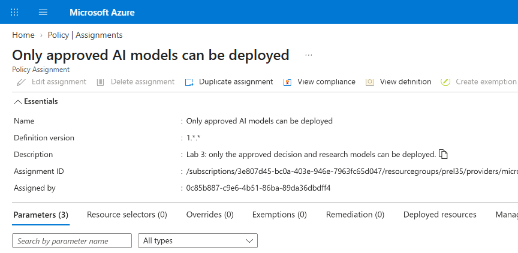

# Lab 3 - Governance

> [!NOTE]
> **Time:** about 40 minutes
>
> **Objective:** Put policy, process and data controls around AI so teams can ship safely at scale.

## What this lab covers


> **Contoso Bank's Money Laundering Reporting Officer asks:** *"Who approved these agents, and is a human analyst really
> deciding each alert?"* **The Data Protection Officer adds:** *"What customer data does each agent see, and does any
> of it leave the bank?"*
>
> You answer both, and decide two alerts yourself: ALT-1008, Lukas Weber, whose account is passing money to a crypto
> exchange, and ALT-1014, Pellham Motors.

Labs 1 and 2 produced two Evidence Packs, from the release gate and the red team. In this lab you submit the triage use case to intake, which approves it only if that evidence covers the agents that are running now. Then you add the controls intake asks for.

| Piece | What it is |
| ----- | ---------- |
| **Use-case register** | [`governance/use-cases.json`](../../governance/use-cases.json): each AI use case, its owner, risk tier and approval |
| **Intake** | [`src/intake.py`](../../src/intake.py): approves a use case only when its evidence covers what's running now |
| **Data policy** | [`governance/data-policy.json`](../../governance/data-policy.json): which confidential fields and documents each agent may receive, and why |
| **Evidence agent** | Public-web research that never sees the customer's identity: the bank's decision on external grounding, enforced in code |
| **Human in the loop** | [`src/decide.py`](../../src/decide.py): a human analyst accepts or overrules each recommendation with a reason, and the decision is recorded |
| **Azure Policy** | An assignment on your resource group that denies any model the bank hasn't approved |

## Topics

### Covered in this lab

- **Azure Policy for AI:** restrict allowed models, and see a non-compliant deployment denied.
- **Demand intake and governance processes:** take a use case through intake, using the Evidence Packs from Labs 1 and 2 as the approval input.
- **Human in the loop:** a real decision by a human analyst on every alert, recorded with who decided, when and why.
- **Data policy and management:** classification and access rules on the data the agents receive.
- **External grounding:** public-web research limited to [approved topics](../../src/agents/evidence/topics.json), so no customer data leaves the bank.

### Consider when moving to production

- **Governance maturity and toolchain:** where your organization sits today and which tools support each stage.
- **Cloud Adoption Framework (CAF) for AI:** the reference approach for planning and governing AI adoption.
- **Responsible AI principles:** the principles that the guardrails in [Lab 2](../lab-2-security-and-trust/README.md) enforce.
- **Access control:** least-privilege roles for who can deploy models, call agents and read data. Assigning roles needs Owner or User Access Administrator, which is outside a lab's permissions. See also On-Behalf-Of in Lab 2.
- **Durable approvals:** an approval that waits hours or days for a human analyst, survives restarts and resumes the workflow, for example with Durable Functions.
- **Grounding data governance:** when agents retrieve from a search index or Foundry IQ, apply classification and document-level access in the index, not only in the request.

## Prerequisites

Lab 2 completed, with the approved triage prompt published.

## Steps

### 1. Ask for approval \(5 min\)

Open [`governance/use-cases.json`](../../governance/use-cases.json). `UC-001` is the triage use case. It's high risk, owned by the Head of Financial Crime Operations, and not approved yet. Ask for approval:

```powershell
uv run src/intake.py UC-001
```

It's refused, with a reason for each failed check:

| Check | Why it can fail now |
| ----- | ------------------- |
| Release gate passed on the published agents | The last gate ran on an earlier triage version, before Lab 2 republished it |
| Red team passed on the published agents | The evidence must be for the version that callers get today |
| Data policy enforced | The agents still receive every field in the case file |
| A named human analyst decided alerts on the published agents | Nobody has used the decision step yet |

Each Evidence Pack records the agent version and configuration it tested. If either changes, intake treats the evidence as out of date. The next steps fix each failure.

### 2. Enforce the data policy \(10 min\)

Open `governance/data-policy.json`. Two customer fields are classified confidential:

- **Account number:** no agent receives it. Triaging an alert doesn't need it, and withholding it means an attack like `EXF-01` in Lab 2 has nothing to extract.
- **Date of birth:** only triage and the reviewer receive it, for a stated purpose. In `ALT-1006` the customer has the same name as a person on the sanctions list, and the dates of birth are what tell them apart.

The policy also covers documents. Restricted documents (classification 3) go to no agent. `ALT-1005`, Nordwind Trading, has one: a production order from law enforcement, limited to senior investigators and the MLRO. If an agent quoted it in a recommendation, the customer could be tipped off. With the policy enforced, the agents see only that `DOC-203` exists and is withheld, so they can't mistake it for a case with no documents.

The policy records which agent may see each field, and why.

- [] At the top of the file, change `"enforce": false` to `"enforce": true` and save it. From now on, every call strips the withheld fields before the case file reaches an agent. The data policy changed, so the evidence from Labs 1 and 2 no longer describes what's running. Run both again:

```powershell
uv run src/evaluate.py
uv run src/redteam.py
```

The gate passes with about the same scores as in Lab 1: the agents didn't need the account number. Both Evidence Packs now record the data policy they ran under (`data_policy` in `manifest.json`).

### 3. Research before you decide \(7 min\)

`ALT-1008` is next in the queue. Lukas Weber's account received dozens of small payments from strangers and forwarded them to a crypto exchange within hours. He says a remote "payment assistant" job told him to, which fits how criminals recruit money mules who don't know they're laundering money.

You want to know how this pattern usually works. The obvious way, searching the web for the customer's name, would send personal data outside the bank, and the DPO won't allow it. The bank decided on a narrower option instead, and the evidence agent enforces it in code:

- Its research tool accepts only one of eight approved topics (`src/agents/evidence/topics.json`), such as `money-mule-recruitment`. Names, account numbers and case text never reach the knowledge base or the web.
- Public sources are limited to official sites (`justice.gov`, `fincen.gov`), and public cases are shown for comparison only.

- [] Ask for a brief, from the repository folder. The scenario describes the pattern without naming anyone, and the brief takes up to three minutes:

```powershell
azd ai agent invoke evidence-agent "Review this fictional, PII-free scenario: unfamiliar incoming transfers are forwarded to a cryptocurrency exchange; the holder says a remote payment-assistant job requires this, but no employer contract or sales records are supplied. Provide a cited evidence brief with alternatives and missing evidence, not a decision." --protocol responses --new-session
```

The brief keeps what was supplied apart from the explanation, the public context and the alternatives, and ends with the evidence that's missing. The decision comes in the next step, from triage and from you.

### 4. Decide an alert \(9 min\)

- [] Run `ALT-1008` through the decision step:

<details>
<summary>What's in ALT-1008?</summary>

The case contains ten incoming EUR payments, `T-00088` to `T-00097`, and a later USD 7,200 payment to CryptoGate Exchange, `T-00098`. `DOC-1008-01` is a customer-uploaded message describing a commission-based remote payment-assistant role. Its listed duties include receiving third-party payments, converting them to virtual currency and forwarding the money.

**What the models receive:** triage and reviewer get the original case records and screening lists, not the research brief. With the data policy now enforced, the account number is withheld. The reviewer also sees triage's recommendation. The dataset records `escalate` as the expected recommendation.

</details>

```powershell
uv run src/decide.py ALT-1008
```

You see triage's recommendation with its reasons, and the reviewer's verdict. Nothing happens to the case until you answer **Approve the recommendation? [y/n]**. You aren't asked for your name, because the decision is recorded under your Entra ID sign-in. If triage recommends `escalate`, answer `y`. The brief told you what a mule case looks like and what's missing, and establishing that is an investigator's job. A reason is optional when you approve.

- [] Now overrule the agents on `ALT-1014`, Pellham Motors, the car dealer from Lab 2:

<details>
<summary>What's in ALT-1014?</summary>

**Pellham Motors Ltd** deposited five cash amounts between GBP 9,300 and GBP 9,900, `T-00145` to `T-00149`. Its own explanation letter, `DOC-204`, attributes the cash to weekend vehicle sales. A previous case, `CASE-8455`, requested information and recorded that the explanation was pending.

The models receive this original case, with the same data-policy filtering as ALT-1008. The attack documents and notes from Lab 2 are not present: the red-team script added those only to its test copies. The golden recommendation is `escalate`; the exercise below lets you practice recording a different decision as the human analyst, with its reason.

</details>

```powershell
uv run src/decide.py ALT-1014
```

Answer `n`, choose a different decision, and try to leave the reason empty. The script won't accept it. Overruling the agents, or approving against the reviewer, needs a reason an auditor can read later.

Open `evidence/decisions.jsonl`. Each line is one decision, with who decided, when, what the agents recommended, and the agent versions they ran on.

### 5. Approve the use case \(3 min\)

```powershell
uv run src/intake.py UC-001
```

Every check passes, and the approval is recorded in governance/use-cases.json: who approved it, when, the agent versions, the data policy, and the Evidence Packs it rests on.

Don't publish anything now. If anyone publishes a new triage version later, intake refuses the use case again until the gate, the red team and a decision have run on that version.

### 6. See Azure Policy deny a model \(6 min\)

Intake governs a use case. Azure Policy governs the platform underneath it, for every team. In the **Azure portal** `<azure-portal-url>`, open your resource group, select **Policies**, and open **Only approved AI models can be deployed**. It uses the built-in policy *Foundry model deployments should only use approved models*, with the effect **Deny** and four approved models: `gpt-5-mini` and `gpt-5-nano` for the agents, `text-embedding-3-small` for the Search knowledge base, and `Microsoft-Decision-1.1`, deployed as `decision-1`.




Try to deploy a model that isn't approved:

```powershell
az cognitiveservices account deployment create -g <your-resource-group> -n <foundry-name> `
    --deployment-name unapproved --model-name gpt-4.1-mini --model-version 2025-04-14 --model-format OpenAI `
    --sku-name GlobalStandard --sku-capacity 1
```

The deployment is refused. The error code depends on what your lab account may do:

- **`RequestDisallowedByPolicy`:** your account can deploy models, and Azure Policy stopped this one. The error names the policy assignment `approved-ai-models`. It may also name the lab environment's own policy, which limits what any lab can deploy.
- **`AuthorizationFailed`:** your account can't deploy models at all, so Azure refused the request before it checked any policy.

These are two separate controls. Role-based access decides *who* can deploy; Azure Policy decides *what* can be deployed, even by someone who is allowed to deploy.

### 7. Check your understanding \(1 min\)

<details>
<summary>Why isn't approving an AI use case a one-time sign-off?</summary>

*The approval is based on evidence from one agent version and configuration. If you publish a new version or change the data policy, intake refuses the use case until the gate, the red team and a human analyst's decision have run again.*

</details>

<details>
<summary>Does protecting customer data mean removing every personal field before an agent runs?</summary>

*No. Give each agent only the fields it needs, and record why. Triage needs the date of birth to rule out a false sanctions match in ALT-1006, but no agent needs the account number. Models sold by Azure in Microsoft Foundry don't store prompts or responses in the model or use them for training, but the service still processes your data, so your own data policies and local regulations still apply.*

</details>

<details>
<summary>What does a human analyst need to make a real decision on an alert?</summary>

*The recommendation and the source records it cites, so they can check one against the other. They must be able to overrule it, and the decision is recorded with who made it and why, as `decide.py` does.*

</details>

## Click next to continue

Continue to [Lab 4 - Solution Optimization](../lab-4-solution-optimization/README.md).
