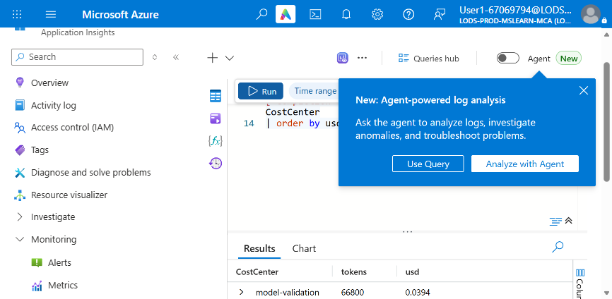

# Lab 4 - Solution Optimization

**Time:** about 40 minutes

**Objective:** Optimize performance, capacity, and cost.

## What this lab covers

> **Contoso Bank's Finance Controller asks:** "What does each alert cost compared with a human analyst doing it by hand,
> and which team pays?"
>
> You answer with numbers, and test a cheaper model on the alerts that matter. ALT-1005, a payment from Nordwind
> Trading to a counterparty on a sanctions list, is the one a cheaper model must not miss.

The agents are approved and running. Now someone asks what they cost, who is paying, and whether it could be
cheaper without being worse. In this lab you answer with numbers: the cost of every release-gate run, a cheaper
model for part of the work and what it does to quality, a decision model that chooses without generating an
explanation, a limit on what any caller can consume, and the bill split by the teams that ran up the tokens.

| Piece | What it is |
| ----- | ---------- |
| **Prices** | [evals/prices.json](../../evals/prices.json): the price per million tokens of each model, including cached input |
| **Model routing** | A gateway switch that sends low-risk alerts to `triage-lite`: the triage instructions on `gpt-5-nano` |
| **Decision model** | `decision-1` (preview): a typed recommendation and probabilities, with GPT used only when an explanation is needed |
| **Token limit** | A gateway policy that caps the tokens each caller can use per minute |
| **Cost attribution** | The gateway records the tokens of every call by cost center, caller and agent, in Application Insights |

## Topics

### Covered in this lab

- **Model selection and routing:** route requests across models and compare cost against quality.
- **Decision models:** separate choosing a disposition from writing an explanation, and measure the cost of each.
- **Gateway policies:** token limits per caller as a gateway policy.
- **FinOps and cost attribution:** cost per run and per alert, and token cost attributed to cost centers and callers.

### Consider when moving to production

- **Semantic caching:** the gateway answers a request from a cache when a similar one was answered before. It needs an embeddings model and a Redis cache, and pays off when requests repeat. Every case file here is different, so it would rarely hit.
- **PTU and capacity planning:** size provisioned throughput (PTU) against measured demand. Not available in this lab environment.
- **Budgets and alerts:** Azure Cost Management budgets per subscription or resource group, and alerts on the token metrics before a team overspends.
- **Cost optimization:** the wider set of levers, from model choice to batching and quotas.

## Prerequisites

[Lab 3](../lab-3-governance/README.md) completed.

## Steps

### 1. What a release costs \(5 min\)

- [] Run the release gate:

```powershell
uv run src/evaluate.py
```

Under the scores you see the cost of the run and the cost per alert: about 3 cents for 14 alerts.

- [] Open the `report.md` it names: the last column shows which model triaged each alert, and the last line the total.

The cost comes from the tokens each call used and [evals/prices.json](../../evals/prices.json). Output tokens cost eight times as much as input tokens, and input the model saw recently, such as the same instructions and screening lists, is cached and costs a tenth. Prompt caching happens on its own; nothing in this lab sets it up.

### 2. Route low\-risk alerts to a smaller model \(8 min\)

`gpt-5-nano` costs a fifth of `gpt-5-mini`. The gateway can send alerts with a low risk score to `triage-lite`, which has the same instructions on the smaller model.

- [] Turn routing on, wait a minute, and run the gate:

```powershell
uv run set-gateway model-routing on
uv run src/evaluate.py
```

- [] Compare the result with step 1:

- **Cost:** about a tenth lower. Only the four alerts scored 65 or less go to `triage-lite`, and the reviewer still runs on `gpt-5-mini` for every alert.
- **Quality:** the blocking metrics usually still pass, sometimes right at the threshold, when the smaller model gets one of its four alerts wrong. Look at the alerts on `gpt-5-nano` in the report: they include ALT-1005, a sanctions hit. A risk score measures how unusual the activity is, not how serious a mistake would be.
- **Reviewer agreement:** usually lower. The reviewer disagrees more often with the smaller model's reasons, and every disagreement is work for a human analyst, which costs far more than the tokens saved.

The gate turns "is the cheaper model good enough?" into numbers anyone can check.

- [] Turn routing off again:

```powershell
uv run set-gateway model-routing off
```

### 3. Try a decision model \(10 min\)

A general-purpose language model writes an answer. A **decision model** answers a typed question against
criteria you supply: here, choose `escalate`, `close_false_positive` or `request_info` from the permitted case
evidence. `decision-1` returns the choice and probabilities, not a written explanation. That lets you pay for
GPT only when someone needs reasons to read. The probabilities are model estimates, not proof that the
recommendation is correct.

The preview model is already deployed in your Foundry resource. Its local rubric is
`src/decisions/prompts/decision1.md`; the prompt agent `triage-systemone` was published in Lab 0.
These samples make billable calls using your existing Azure CLI sign-in and `.env`.

#### Choose, explain, review

- [] Run Harbour Lane Bakery through the three-step runner:

```powershell
uv run python src/decisions/triage_systemone.py ALT-1001
```

Read **What was called, and what it cost**. Decision-1 chooses the disposition first. The GPT agent then writes
cited reasons, gaps and conflicts; it cannot change that disposition. Decision-1 reviews the recommendation
afterwards. If the explanation needs a repair, the extra GPT call appears in the same list.

- [] Compare the time and cost of choosing with the total, and check the explanation's citations.

The explanation is an additional expense, not another vote. An explanation supported by case records is not
access to the decision model's internal reasoning. Add `--json` if you want the full record.

#### Choose and review without GPT

- [] Try Lukas Weber's possible money-mule activity without an explanation-writing call:

```powershell
uv run python src/decisions/investigate_decisions.py ALT-1008 --challenge
```

The table shows a disposition, a reviewer verdict and their model confidence. The expected disposition is
`escalate`. `--challenge` also gives the reviewer the two wrong dispositions; it should disagree with both.
There are no GPT calls and no written issue list.

- [] Check whether the reviewer caught both wrong dispositions, and consider whether the analyst needs an explanation.

A mismatch or unavailable call makes the run exit with an error; read the result rather than treating it as
an approval.

#### Compare the investigations

Allow **about 1-1.5 minutes** for this comparison. Read the explanation below while it runs.

- [] Start the comparison on seven alerts (half the dataset). Leave it running and read the explanation below:

```powershell
uv run python src/decisions/compare_investigations.py ALT-1001 ALT-1002 ALT-1005 ALT-1006 ALT-1008 ALT-1010 ALT-1013 --workers 2
```

**While it runs**

Both paths triage and review the same policy-filtered cases. The classic path uses the GPT agents through the gateway; the other uses Decision-1 directly. Golden labels are used for scoring, never sent to the models. The seven alerts cover escalations, false positives and requests for more information, including both a real sanctions hit and a false name match.

The script runs the GPT investigation first, then Decision-1, and prints the comparison when both finish. It also makes a Decision-1 warm-up triage and review before timing. This sample makes 14 GPT calls and 16 Decision-1 calls including warm-up, rather than 28 and 30 for all 14 alerts, before any retries.

Compare what each path produces as well as what it costs. GPT writes reasons and reviewer issues; Decision-1 returns a disposition, probabilities, and a reviewer verdict and confidence. A cheaper label-only path is not the same service as one that supplies an explanation for a human analyst.

**When it finishes**

- [] Read the side-by-side **Cost per alert**, **Per alert (triage + review)**, **Triage matches golden**, **Escalation recall**, **Reviewer disagrees** and **Unavailable**. For ALT-1005, the sanctions-hit case, the expected recommendation is `escalate`. Check whether both models got it right.

In **Different results**, the checkmark means the triage recommendation matches the golden answer; the cross means it does not. **Reviewer: agree** only means that path's reviewer accepted its recommendation, which may still be wrong.

Evidence is saved under `evidence/investigation-comparison/`.

The classic reviewer supplies issues; Decision-1 supplies only a verdict and confidence. The displayed Decision-1 cost estimates use $0.042 per million input tokens; output tokens are free. You also need to account for explanation quality, human review and the gateway controls the direct path bypasses.

If time and capacity allow, omit the alert IDs to compare all 14 later. That larger run is optional, not needed to complete this step.

### 4. Limit tokens per caller \(5 min\)

A single runaway script can use the capacity every team shares. The gateway limits the tokens each caller can use per minute; the default is high.

- [] Set the limit below what one alert needs:

```powershell
uv run set-gateway token-limit 3000
```

- [] Wait a minute, then run one alert with the client's retries shown:

```powershell
$env:OPENAI_LOG = 'info'
uv run src/investigate.py ALT-1001
Remove-Item Env:OPENAI_LOG
```

The triage call uses most of the 3,000 tokens. The reviewer call gets HTTP 429 from the gateway, with a `Retry-After` header, and the client waits and retries until the minute resets. The work still finishes, slowly: the limit protects everyone else's capacity, not the caller's deadline.

- [] Restore the default:

```powershell
uv run set-gateway token-limit 200000
```

### 5. Attribute the cost \(9 min\)

Every call through the gateway carries a cost center (`x-cost-center`): the release gate charges model validation, the red team security testing, and a human analyst's investigation financial crime operations. The gateway records the tokens of each call by cost center, caller and agent.

- [] In the **Azure portal** +++<azure-portal-url>+++, open the Application Insights resource (`<appinsights-name>`) in your resource group and select **Logs**. Switch to **KQL mode** if needed, paste this query into the query editor and select **Run**.

Token metrics take a few minutes to arrive, so recent calls may not show at first:

```kusto
let prices = datatable(Agent: string, input: real, cached: real, output: real) [
    "triage", 0.25, 0.025, 2.0,
    "reviewer", 0.25, 0.025, 2.0,
    "triage-lite", 0.05, 0.005, 0.4
];
customMetrics
| where name in ("Prompt Tokens", "Prompt Cached Tokens", "Completion Tokens")
| extend CostCenter = tostring(customDimensions["Cost center"]), Agent = tostring(customDimensions["Agent"]),
         Caller = tostring(customDimensions["Caller"])
| summarize tokens = sum(valueSum) by CostCenter, Caller, Agent, name
| evaluate pivot(name, sum(tokens))
| lookup prices on Agent
| extend usd = ((['Prompt Tokens'] - ['Prompt Cached Tokens']) * input + ['Prompt Cached Tokens'] * cached + ['Completion Tokens'] * output) / 1000000
| summarize tokens = sum(['Prompt Tokens'] + ['Completion Tokens']), usd = round(sum(usd), 4) by CostCenter
| order by usd desc
```

Model validation is most of the bill: you ran the gate more often today than anyone triaged an alert.



- [] Change `by CostCenter` on the last `summarize` line to `by Caller` and run the query again to see the cost per person.

A call that sends no cost center is recorded as `unassigned`: it still counts, but nobody can be charged for it. The lab's gateway clients always send one. In production, the gateway would refuse calls without one, or derive it from the caller's identity, because a header alone is whatever the caller says it is.

The direct Foundry calls from step 3 are not in this gateway breakdown. Use their local evidence for this
experiment; a production decision-model path would need equivalent controls and cost attribution.

### 6. Wrap up \(3 min\)

You can now answer the Finance Controller with the three numbers a FinOps review asks for: what each alert costs
(from the gate), who consumed it (per cost center and caller, from the gateway), and what a cheaper option would do
to quality (from the gate, with routing on). The decision-model experiment adds a fourth question: how much
work needs a generated explanation, and what does that explanation add to the cost?

## You've completed the labs

Every Contoso Bank stakeholder now has an answer, backed by something you produced:

| Asked by | Their question | Your answer, and where it's recorded |
| -------- | -------------- | ------------------------------------ |
| Head of Financial Crime Operations | Can the agents just close alerts? | No. They recommend, a named human analyst decides: `evidence/decisions.jsonl` |
| Head of Model Risk Management | How do we know a change is still good enough? | The release gate on every change: the Evidence Pack from Lab 1 |
| Chief Information Security Officer | What stops a letter telling the agent to close its own case? | The prompt, Prompt Shields at the gateway and the guardrail: the red team Evidence Pack from Lab 2 |
| Data Protection Officer | What does each agent see, and does anything leave the bank? | The data policy, and research by approved topic only: `governance/data-policy.json` |
| Money Laundering Reporting Officer | Who approved this? | Intake, on current evidence: `governance/use-cases.json` |
| Finance Controller | What does it cost, and who pays? | Cost per alert and per cost center: the gate report and Application Insights |

The same path applies to any agent you take to production: decide the boundary, measure every change, attack it
before someone else does, govern what it sees and who approved it, and know what it costs.
